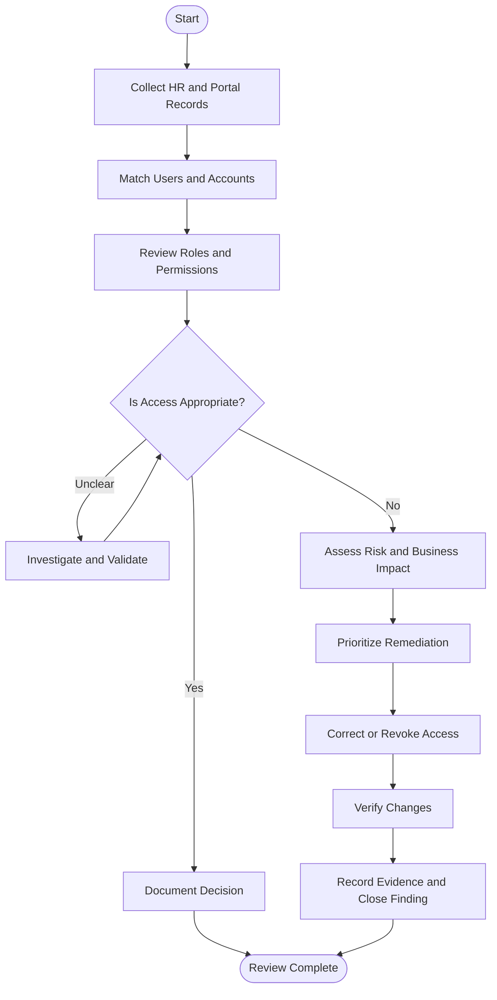

# 07 — Access Review Workflow
Project: Northwind Health | IAM Access Review  
Document Reference: IAM-DOC-07-WF  
Version: 1.0  
Status: Draft — Portfolio Case Study  
Assessment Date: 5 October 2026  
Classification: Public — Fictional Data  

# 1. Workflow Overview
This workflow shows how Northwind Health reviews user access, investigates risks, and verifies corrective actions.

# 2. Access Review Process

    
  # 3. Key Control Points
  
| Control | Purpose |
|---|---|
| Identity Reconciliation | Match HR records against application accounts. |
| Access Validation | Confirm permissions match job responsibilities. |
| Risk Assessment | Prioritize issues by severity and business impact. |
| Remediation | Correct inappropriate or excessive access. |
| Verification | Confirm changes and retain supporting evidence. |

# 4. Expected Outcome
A consistent review process that reduces unnecessary access, improves accountability, 
and helps protect sensitive healthcare information.

---

Next Document: 08-executive-summary.md
